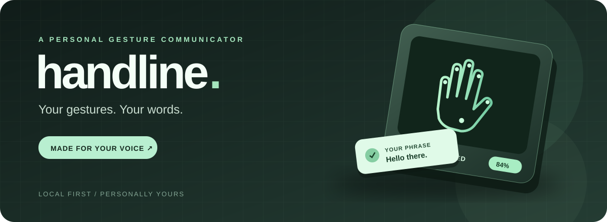
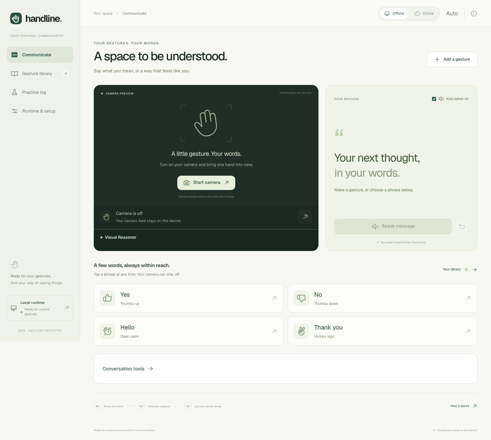

<div align="center">
  
  <p><strong>A personal gesture communicator that gives your movements a voice.</strong></p>
  <p>One or two hands &nbsp;·&nbsp; Your own phrases &nbsp;·&nbsp; Local and online modes</p>
  <p><a href="#get-started">Get started</a> &nbsp; / &nbsp; <a href="#how-it-works">How it works</a> &nbsp; / &nbsp; <a href="#configuration">Configuration</a> &nbsp; / &nbsp; <a href="#validation">Validation</a></p>
</div>

---

## A gesture can say a lot

Handline connects a gesture you choose to a phrase you choose. Enroll examples with your webcam, hold a pose, and see or hear your saved words. Presets and manual phrase buttons give you a place to start; custom gestures make the vocabulary yours.

<table><tr><td width="50%"><strong>01 / PERSONAL</strong><br/>Record single- or two-hand gestures and assign each an exact phrase.</td><td width="50%"><strong>02 / VISIBLE</strong><br/>See a live match score and inspect the visual comparison when verification is enabled.</td></tr><tr><td><strong>03 / FLEXIBLE</strong><br/>Use local recognition and device speech, or opt into cloud features.</td><td><strong>04 / EXPRESSIVE</strong><br/>Try ElevenLabs voices and review optional model-assisted phrase drafts before speaking.</td></tr></table>

<p align="center"></p>
<p align="center"><em>The interface adapts to desktop and mobile screens, with system, light, and dark themes.</em></p>

## How it works

```text
 Webcam → MediaPipe hand landmarks → normalized pose → similarity score
                                                        ↓
                                      threshold + stable hold + release
                                                        ↓
                           optional Gemma visual check → saved phrase → speech
```

MediaPipe runs in the browser and tracks up to two hands. Each hand has 21 landmarks; Handline compares normalized landmark vectors against the user's enrolled examples. The displayed score is a pose similarity measure, not a calibrated probability. The default threshold is 50%, and ambiguous or unstable poses do not trigger a phrase. A held gesture must be released before it can trigger again.

For custom gestures, the configured Gemma runtime can verify a labeled contact sheet containing the live pose and references. Handline validates the returned gesture ID and uses the user's saved phrase. MediaPipe and Gemma are pretrained; enrollment stores examples for matching and does not train model weights. Handline is a prototype for personal communication, not a sign-language translator.

## Get started

You need Node.js 22.12 or later (Node 24+ recommended), npm, a webcam, and a current Chrome, Edge, or Safari browser. For local Gemma verification, install [Ollama](https://ollama.com/download) and allow sufficient disk space and memory for the model.

```sh
git clone https://github.com/TatvagnaTandel/handline.git
cd handline
npm install
npm run setup:assets
ollama pull gemma4:12b
npm run dev
```

Open **http://localhost:5173**. Ensure Ollama is running for local model verification. The development server starts the UI and local bridge. The asset setup downloads the MediaPipe model and copies its WebAssembly runtime locally. Model size and performance depend on your machine.

1. Use a preset or tap a phrase to communicate without the camera.
2. Start the camera and hold a gesture steady. Release it before repeating.
3. Add a gesture, select one or two hands, record examples, and save your phrase.
4. Choose a runtime, adjust the match threshold, and select your preferred voice under **Runtime & setup**.
5. Use the practice log to record recognition trials and export results.

Browser storage belongs to the exact origin: `localhost:5173`, `127.0.0.1:5173`, and `localhost:8787` have separate vocabularies.

## Choose your voice

Device speech works locally when a suitable device voice is available. ElevenLabs adds optional online speech, voice selection, and voice banking. Configure the key on the server, select ElevenLabs in the app, and grant session consent. Generated phrase audio can be cached in IndexedDB; offline playback uses cached audio or a device voice. Partner transcription and voice creation require explicit user action.

Conversation tools can compose or expand phrases and suggest saved responses. Generated drafts are editable and require a deliberate **Speak reviewed draft** action. A priority two-hand gesture raises a local attention message; it does not contact emergency services.

## Configuration

Copy `.env.example` to `.env.local`, set only the values you need, and restart the server. Keep keys in the server environment; never commit them.

| Variable | Purpose |
| --- | --- |
| `GEMINI_API_KEY` | Optional cloud Gemma credential |
| `GEMINI_MODEL` | Cloud model override |
| `OLLAMA_MODEL` | Local model override, default `gemma4:12b` |
| `OLLAMA_URL` | Local Ollama endpoint, default `http://127.0.0.1:11434` |
| `ELEVENLABS_API_KEY` | Optional server-side ElevenLabs credential |
| `HEADROOM_URL` | Optional local Headroom proxy for conversation history |
| `PORT` | Bridge and production UI port, default `8787` |

Cloud image verification needs a configured Gemini key and explicit session consent. Normal landmark matching is local; cloud verification sends a selected contact sheet, not a continuous video stream. Gestures, references, and settings are stored in browser IndexedDB; conversation history is kept in memory. See [feature ideas and Headroom setup](docs/FEATURE_IDEAS.md) for details.

For a production build served locally:

```sh
npm run build
npm start
```

Open http://localhost:8787. Camera access requires localhost or HTTPS.

## Validation

```sh
npm test
npm run build
npx playwright install chromium
npm run test:e2e
HANDLINE_LIVE_MODEL=1 npm run test:e2e
```

Browser automation uses fixture images and mocks speech. Live ElevenLabs TTS was exercised separately; personal voice cloning and transcription have not been live-tested with personal audio. Scores and thresholds are prototype settings, and the product has not been clinically validated. See [validation details](docs/VALIDATION.md) and [ElevenLabs evidence](docs/ELEVENLABS_VALIDATION.md).

---

<div align="center"><strong>Made for the words that matter.</strong><br/><sub>React · TypeScript · MediaPipe · Gemma · ElevenLabs</sub></div>
