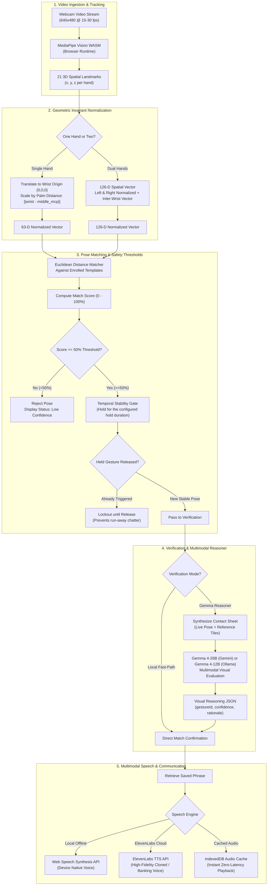
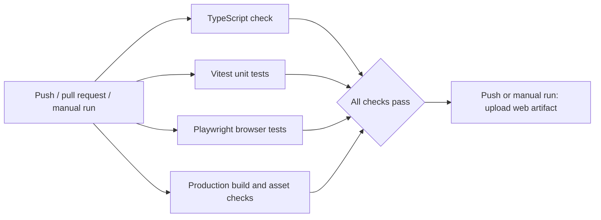
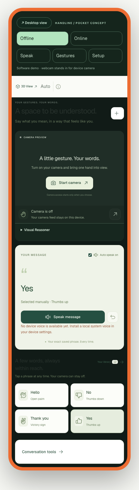

<div align="center">
  

  <p><strong>A personal gesture communicator that gives your movements a voice.</strong></p>
  <p>One or two hands &nbsp;·&nbsp; Scale-invariant landmarks &nbsp;·&nbsp; Multimodal Gemma reasoning &nbsp;·&nbsp; ElevenLabs voice banking</p>

  <p>
    <a href="https://github.com/TatvagnaTandel/handline/actions/workflows/ci.yml"></a>
    <a href="tests/unit"></a>
    <a href="tests/e2e"></a>
    <a href="tsconfig.json"></a>
    <a href="package.json"></a>
    <a href="docs/showcase/index.html"></a>
    <a href="https://ai.google.dev"></a>
    <a href="https://elevenlabs.io"></a>
    <a href="package.json"></a>
  </p>

  <p>
    <a href="#-interactive-3d-landmark--gesture-studio-threejs">3D WebGL Studio</a> &nbsp;·&nbsp;
    <a href="#-system-architecture">Architecture</a> &nbsp;·&nbsp;
    <a href="#-key-features">Key Features</a> &nbsp;·&nbsp;
    <a href="#-ci--cd-pipeline">CI/CD Pipeline</a> &nbsp;·&nbsp;
    <a href="#-quickstart">Quickstart</a> &nbsp;·&nbsp;
    <a href="#-configuration">Configuration</a> &nbsp;·&nbsp;
    <a href="#-validation--testing">Validation</a>
  </p>
</div>

---

## 🎮 Interactive 3D Landmark & Gesture Studio (Three.js)

Experience how Handline captures, normalizes, and verifies spatial hand poses in real-time with our **WebGL 3D Interactive Studio**, rendered using **Three.js**.

<div align="center">
  <a href="docs/showcase/index.html">
    
  </a>
  <p><em>Click <strong>3D View</strong> in the app navigation bar or visit <code>/showcase/</code> to launch the interactive viewport.</em></p>
</div>

### What You Can Explore in the 3D Studio:

1. **Articulated 21-Joint Hand Kinematics**:
   - Each hand is rendered as a fully articulated skeleton consisting of 21 spherical joint nodes connected by 20 directional anatomical bone cylinders (Wrist $\rightarrow$ CMC $\rightarrow$ MCP $\rightarrow$ PIP $\rightarrow$ DIP $\rightarrow$ Fingertip).
   - Joint coordinates mirror MediaPipe's $(x, y, z)$ spatial coordinate space with real-time wrist normalization.

2. **Dual-Hand 126-D Vector Representation**:
   - Toggle between single-hand (63 coordinates) and dual-hand (126 coordinates) configurations.
   - An active holographic connection beam visualizes the inter-wrist vector distance $d(\text{wrist}_L, \text{wrist}_R)$, capturing coordinated two-handed gestures like *Dual Namaste* and *Dual Framing*.

3. **Smooth Pose Morphing Interpolation (`lerp`)**:
   - Select between calibrated pose targets (*Open Palm*, *Thumbs Up*, *Thumbs Down*, *Victory Sign*, *Dual Namaste*, and *Dual Framing*).
   - The engine performs real-time linear spherical interpolation across all 21 joint vectors with natural joint velocity damping.

4. **Interactive Raycasting Joint Inspector**:
   - Hover or tap any joint in 3D space to trigger a real-time raycaster HUD card displaying anatomical joint names (e.g., `INDEX_FINGER_PIP`), normalized $(x, y, z)$ offsets, and parent bone attachments.

5. **Gemma Visual Reasoner Hologram**:
   - Toggle the floating contact sheet plane to inspect the exact multi-tile visual reasoning grid generated for Gemma verification, along with simulated visual match confidence.

6. **Simulated Acoustic Voice Pulse**:
   - Trigger the speech synthesizer pulse button to observe concentric dynamic wave rings radiating outward from the palm, demonstrating the link between physical gesture and vocal speech synthesis.

7. **100% Offline Capable**:
   - The 3D studio includes bundled local copies of `three.module.js` and `three.core.js` copied during `npm run setup:assets`, eliminating third-party CDN latency and ensuring complete offline operation.

> **How to Run the 3D Studio Locally:**
> - In development: Start the dev server with `npm run dev` and click **3D View** in the topbar or open [http://localhost:5173/showcase/](http://localhost:5173/showcase/).
> - In production: Start the app with `npm start` and visit [http://localhost:8787/showcase/](http://localhost:8787/showcase/).
> - Standalone static preview: Open `docs/showcase/index.html` in your browser or run `npx serve .`.

---

## 🏛️ System Architecture

Handline operates on a **dual-engine hybrid pipeline**: local-first invariant landmark tracking for ultra-low latency continuous recognition, coupled with on-demand multimodal Gemma visual verification.

### End-to-End Multimodal Vision & Speech Pipeline



---

## 🌟 Key Features

| Capability | Technical Implementation | Value to User |
| :--- | :--- | :--- |
| **Dual-Hand Gestures** | 126-D coordinate vector concatenation combining left and right hand landmarks plus inter-wrist Euclidean distance vector $d(\text{wrist}_L, \text{wrist}_R)$. | Express complex, natural concepts (e.g., *Namaste*, *Framing*, *Time out*, *Big/Small*) that single-hand systems miss. |
| **Match Score Threshold** | Strict $\ge 50\%$ threshold gate with live percentage match score badge and visual color indicator (`#4e876e` active / `#8b9588` muted). | Reduces accidental outputs; recognition performance depends on conditions and enrollment. |
| **Gemma Visual Reasoner** | Multimodal verification using contact sheets sent to local Ollama (`gemma4:12b`) or Google Gemini (`gemma-4-26b-a4b-it`) with collapsible reasoning drawer. | Shows the comparison sheet and an optional model-generated visual explanation. |
| **ElevenLabs Voice Banking** | Official `@elevenlabs/elevenlabs-js` integration with voice selection, multilingual speech models, instant voice cloning, and IndexedDB audio caching. | Users maintain their own authentic vocal identity, tone, and inflection instead of robotic speech. |
| **Dark / Light Theme** | System-synchronized color scheme with manual override toggle, persists in `localStorage` with zero layout shift. | Comfortable use in bright daylight, low-light bedside environments, or high-contrast assistive setups. |
| **Local-First Privacy** | MediaPipe runs completely inside the browser WASM sandbox; local Gemma verification runs through Ollama on `localhost:11434`. | Zero personal hand imagery or audio streams leave the user's computer without explicit toggle consent. |
| **Hold-to-Speak Lockout** | State machine requires a continuous timed hold followed by mandatory physical release before re-triggering. | Prevents runaway phrase repeats and stuttering loops while holding a comfortable hand pose. |
| **Practice & Trial Log** | Built-in trial recorder that logs trials, accuracy rates, false acceptances, and false rejections with JSON export. | Clinicians, speech therapists, and users can objectively evaluate progress and gesture consistency. |

---

## 🔄 CI / CD Pipeline

**Activation pending:** the workflow is prepared locally, but GitHub rejected its upload because the available token lacks the `workflow` permission. The pipeline below describes that prepared configuration; it is not yet active on GitHub.

The prepared GitHub Actions workflow (`.github/workflows/ci.yml`) is configured to run on pushes to `main`, `master`, and `develop`, pull requests targeting `main` or `master`, and manual dispatch. Jobs run on Ubuntu with Node.js 22 and install dependencies with `npm ci`.



| Stage | What runs | Output |
| --- | --- | --- |
| Type checking | Asset preparation, then `npm run typecheck` | TypeScript validation |
| Unit tests | `npm test` | Matching, recognition lifecycle, provider and endpoint checks |
| Browser tests | Asset preparation, Chromium installation, then `npm run test:e2e` | Browser results; failure artifacts retained for 7 days |
| Production build | Asset preparation and `npm run build` | Checks for `dist/index.html` and the MediaPipe model |
| Delivery | After all four stages pass, rebuild and upload `dist/` | `handline-web-<commit SHA>` artifact, retained for 14 days; skipped for pull requests |

Download the web artifact from the successful run's **Artifacts** section in [Actions](https://github.com/TatvagnaTandel/handline/actions). It contains the frontend assets; the Express server is still required for API features. Live Gemini, ElevenLabs, and local Ollama inference are outside this CI run. No API keys are required for the automated checks.

### macOS installer

[Download Handline 1.0.0 for Apple Silicon](https://github.com/TatvagnaTandel/handline/releases/download/v1.0.0-macos-arm64/Handline-1.0.0-arm64.dmg) · [Release notes](https://github.com/TatvagnaTandel/handline/releases/tag/v1.0.0-macos-arm64)

Open the DMG and drag Handline into Applications. This development prerelease is ad-hoc signed and not Apple-notarized. Ollama/Gemma are installed separately; credentials are excluded. The release was built with preserved local changes, as recorded in its release notes. DMG creation and release upload are currently manual; the workflow delivers web build artifacts and does not deploy a hosted application.

---

## 🚀 Quickstart

### Prerequisites
- **Node.js**: 22.12 or later (Node 24 recommended).
- **Webcam**: Standard built-in or external USB camera.
- **Browser**: Modern Chrome, Edge, or Safari with WebAssembly and WebGL support.
- **Local Gemma (Optional)**: [Ollama](https://ollama.com/download) with `gemma4:12b` pulled.

### Installation

```sh
# 1. Clone repository
git clone https://github.com/TatvagnaTandel/handline.git
cd handline

# 2. Install dependencies
npm install

# 3. Download MediaPipe model & prepare local Three.js assets
npm run setup:assets

# 4. (Optional) Pull local Gemma vision model for offline visual reasoning
ollama pull gemma4:12b

# 5. Start development environment (Express bridge + Vite dev server)
npm run dev
```

Open **[http://localhost:5173](http://localhost:5173)** in your browser.

---

## ⚙️ Configuration

Copy `.env.example` to `.env.local` to configure optional cloud reasoning and voice banking:

```sh
cp .env.example .env.local
```

### Environment Variables

| Variable | Default | Description |
| :--- | :--- | :--- |
| `GEMINI_API_KEY` | *None* | Google Gemini API key for cloud Gemma multimodal verification. |
| `GEMINI_MODEL` | `gemma-4-26b-a4b-it` | Cloud model override (supports Google AI Studio endpoints). |
| `ELEVENLABS_API_KEY` | *None* | ElevenLabs API key for voice banking, speech synthesis, and voice cloning. |
| `OLLAMA_URL` | `http://127.0.0.1:11434` | Endpoint for local Ollama service. Must remain local (`localhost`). |
| `OLLAMA_MODEL` | `gemma4:12b` | Local Ollama vision model name. |
| `PORT` | `8787` | Express backend bridge and production server port. |

> [!NOTE]
> All credentials remain strictly on the server backend bridge (`server/index.ts`). They are never exposed to client-side browser bundles.

---

## 🧪 Validation & Testing

Execute the test suites locally to match the CI/CD pipeline:

```sh
# Typecheck TypeScript codebase
npm run typecheck

# Run 42 Vitest unit tests
npm test

# Run all Playwright E2E browser tests (including 3D showcase)
npm run test:e2e

# Run production build and verify bundle artifacts
npm run build
```

---

<div align="center">
  <sub>Handline is an assistive multimodal prototype designed for accessible communication.</sub><br/>
  <strong>Made with React · TypeScript · Three.js · MediaPipe · Gemma · ElevenLabs</strong>
</div>

## Handheld device demo

[Download the Apple Silicon handheld demo DMG](https://github.com/TatvagnaTandel/handline/releases/tag/v1.0.0-handheld-demo).

For a separate handheld presentation, select **Handheld demo** in the app, or open `/?device=handheld`. The macOS app also offers **Demo → Handheld demo** and **Demo → Desktop demo**. The orange device frame uses the existing webcam recognition, saved phrases, runtime selection, and speech engine. This is a software concept demonstration; physical buttons, battery telemetry, cellular connectivity and device hardware are not connected.


